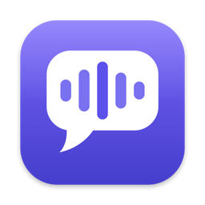
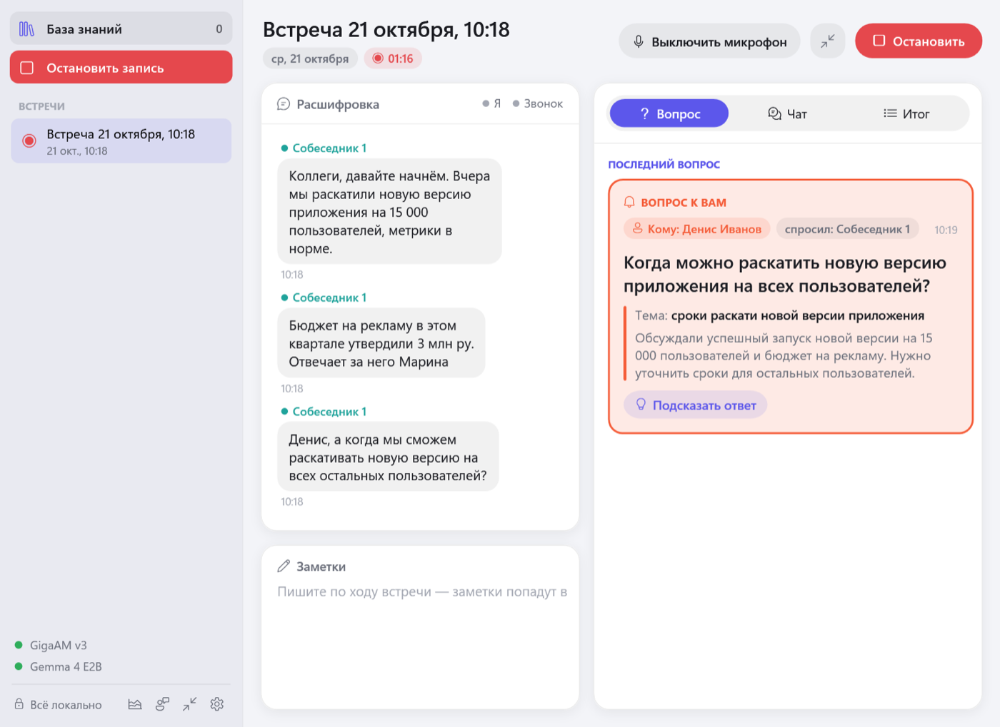
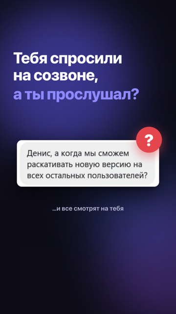
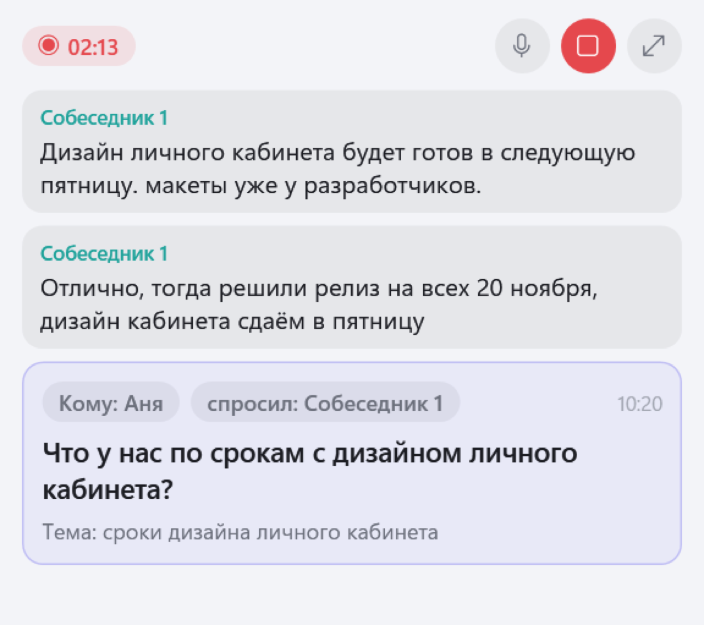
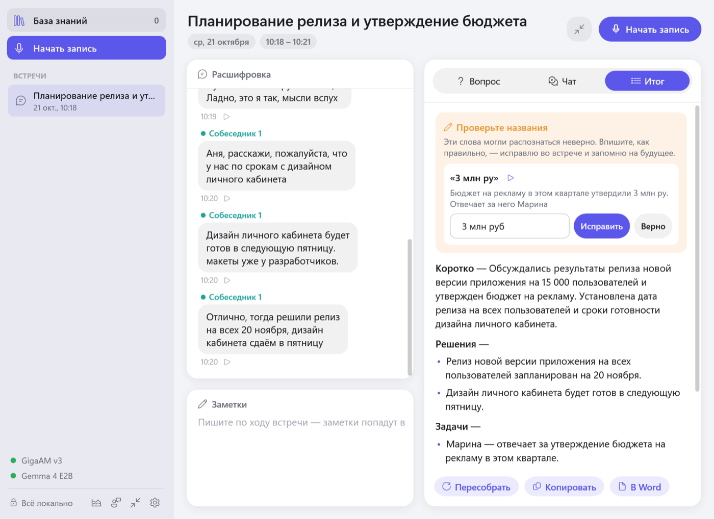
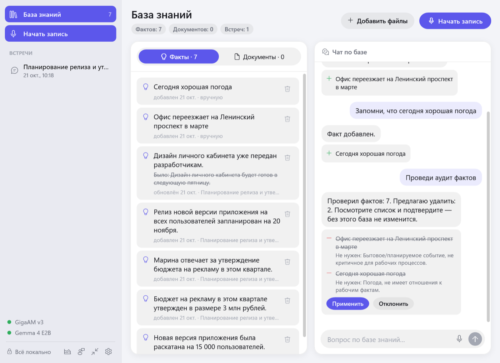
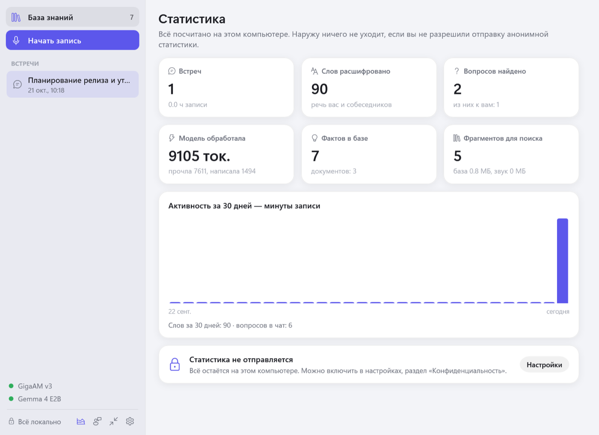

<div align="center">



# Суфлёр

**Подсказывает на созвонах: что спросили, кого и о чём шла речь.**
Расшифровка, последний вопрос, итог встречи и база знаний — прямо на вашем компьютере, без облака.

[](https://github.com/madebyhidden/sufler/releases/latest/download/Sufler-mac.dmg)
[](https://github.com/madebyhidden/sufler/releases/download/win-channel/Sufler-windows.zip)

[](LICENSE)




<a href="docs/video/sufler-reels.mp4"></a><br>
<sub>▶ <a href="docs/video/sufler-reels.mp4">Ролик на 33 секунды</a></sub>

</div>

## Зачем

На созвоне легко отвлечься — и через секунду услышать своё имя и вопрос, который вы прослушали. Суфлёр слушает разговор вместе с вами и держит перед глазами главное:

- **Последний вопрос** — кому адресован, кто спросил, тема и короткий контекст. Риторические вопросы и «алло, слышно?» отсеиваются.
- **«Вопрос к вам»** — если обратились к вам по имени, карточка подсвечивается и приходит уведомление.
- **Подсказка ответа** — по ходу разговора и по вашей базе знаний.

Работает с любым приложением для звонков: Zoom, Telegram, Google Meet, Teams, Телемост — Суфлёр слышит ваш микрофон и звук компьютера.

## Что умеет

| | |
|---|---|
| 🎙 **Живая расшифровка** | Русская речь превращается в текст во время звонка; собеседники различаются по голосу, каждому можно дать имя |
| ❓ **Последний вопрос** | Кому, кто, тема, контекст — и подсказка ответа одной кнопкой |
| 🧾 **Итог встречи** | Коротко, решения, задачи «кто — что», открытые вопросы; копирование и экспорт в Word |
| 📚 **База знаний** | Факты из встреч копятся сами и обновляются, когда цифры меняются; ваши PDF и Word; чат по всему этому |
| 💬 **Чат по встрече** | «О чём договорились?», «кто отвечает за бюджет?» — ответ по всей расшифровке. Вопрос можно задать голосом |
| 🔤 **Проверка названий** | После встречи покажет слова, которые могли распознаться неверно; исправления запоминаются в словаре |
| 🔁 **Переслушать реплику** | Звук встречи сохраняется сжатым, любую реплику можно прослушать |
| 📌 **Компактный режим** | Маленькое окно поверх всех окон: две последние реплики и вопрос |
| 📞 **Начало звонка** | Zoom или браузер включил микрофон — Суфлёр предложит начать запись |
| 🧑‍💼 **Режим собеседований** | Подготовка по вакансии и резюме, карта вопросов, уточнения по ходу, оценка кандидата |

<table>
<tr>
<td></td>
<td></td>
</tr>
<tr>
<td align="center">Компактное окно поверх звонка</td>
<td align="center">Итог встречи и проверка названий</td>
</tr>
<tr>
<td></td>
<td></td>
</tr>
<tr>
<td align="center">База знаний и чат по ней</td>
<td align="center">Личная статистика</td>
</tr>
</table>

## Всё на вашем компьютере

- Распознавание речи, поиск вопросов, итоги и чат работают на локальных моделях. Интернет нужен только чтобы один раз скачать модели и получать обновления.
- Звук, расшифровки, итоги, заметки и база знаний никуда не отправляются.
- Анонимная статистика — только если вы разрешите, и только счётчики: минуты записи, число слов и вопросов, версия приложения. Без согласия не уходит ничего. Что именно отправляется, видно в настройках, а код сервера, который её принимает, лежит в [`server/`](server/collector.py).
- Исходный код открыт — это можно проверить.

## Установка

**Mac** (Apple Silicon M1 и новее, macOS 14.2+, от 16 ГБ памяти):
1. Скачайте [Sufler-mac.dmg](https://github.com/madebyhidden/sufler/releases/latest/download/Sufler-mac.dmg) и перетащите «Суфлёр» в «Программы».
2. Приложение не подписано сертификатом Apple — при первом запуске откройте его через Системные настройки → Конфиденциальность и безопасность → «Всё равно открыть». Если macOS пишет «Не удаётся открыть», выполните в Терминале:
   ```bash
   xattr -cr /Applications/Суфлёр.app && codesign --force --deep -s - /Applications/Суфлёр.app && open /Applications/Суфлёр.app
   ```
3. При первом запуске Суфлёр скачает модели (около 5 ГБ) и попросит доступ к микрофону и звуку системы.

**Windows** (10 или 11, 64 бита, от 8 ГБ памяти; видеокарта не обязательна):
1. Скачайте [Sufler-windows.zip](https://github.com/madebyhidden/sufler/releases/download/win-channel/Sufler-windows.zip), распакуйте папку целиком и запустите `Sufler.exe`.
2. Если SmartScreen предупредит — «Подробнее» → «Выполнить в любом случае».
3. Приложение само выберет модели под ваш компьютер (на ноутбуке без видеокарты — лёгкие) и скачает их.

Дальше обе версии обновляются сами — появится кнопка «Обновление».

## Как это устроено

| Задача | Mac | Windows |
|---|---|---|
| Распознавание речи | Whisper large-v3-turbo (whisper.cpp, Metal) | GigaAM v3 (sherpa-onnx, процессор) или Whisper |
| Вопросы, итоги, чат | Gemma 4 E4B (llama.cpp) | Gemma 4 E4B или E2B — по железу |
| Поиск по базе | EmbeddingGemma 300M | EmbeddingGemma 300M |
| Голоса | pyannote + WeSpeaker (FluidAudio, Core ML) | pyannote + CAM++ (sherpa-onnx) |
| Интерфейс | SwiftUI | WPF (.NET 10) |

Обе версии нативные: на Mac — Swift, на Windows — C#. Логика Windows-версии вынесена в отдельную библиотеку [`windows/Sufler.Core`](windows/Sufler.Core), которая собирается и проверяется на любой системе.

```
Sources/Sufler/        версия для Mac (SwiftUI)
windows/Sufler.Core/   логика Windows-версии без интерфейса
windows/Sufler.Win/    интерфейс Windows-версии (WPF)
server/                приёмник анонимной статистики и отзывов
scripts/               вспомогательные скрипты
```

## Сборка из исходников

**Mac** — нужны Xcode Command Line Tools:
```bash
./scripts/fetch-vendor.sh     # whisper.cpp и llama.cpp
./build.sh                    # Sufler.app; модели приложение скачает само при первом запуске
```

**Windows** — нужен .NET 10 SDK (собирается и на Mac):
```bash
dotnet publish windows/Sufler.Win -c Release -r win-x64 --self-contained -o out
```

## Планы

Что осталось до версии 1.0 — в [ROADMAP.md](ROADMAP.md). Идеи и ошибки — через кнопку «Отзыв» в приложении или в [Issues](https://github.com/madebyhidden/sufler/issues).

## Лицензия

[AGPL-3.0](LICENSE). Можно пользоваться, изучать и менять код; если вы распространяете изменённую версию или запускаете её как сервис, исходники изменений нужно открыть под той же лицензией. Для другого использования напишите автору.

Суфлёр стоит на плечах открытых проектов — список в [THIRD_PARTY.md](THIRD_PARTY.md). Модели скачиваются с их официальных страниц и распространяются на условиях их авторов (Gemma — [условия Google](https://ai.google.dev/gemma/terms)).
